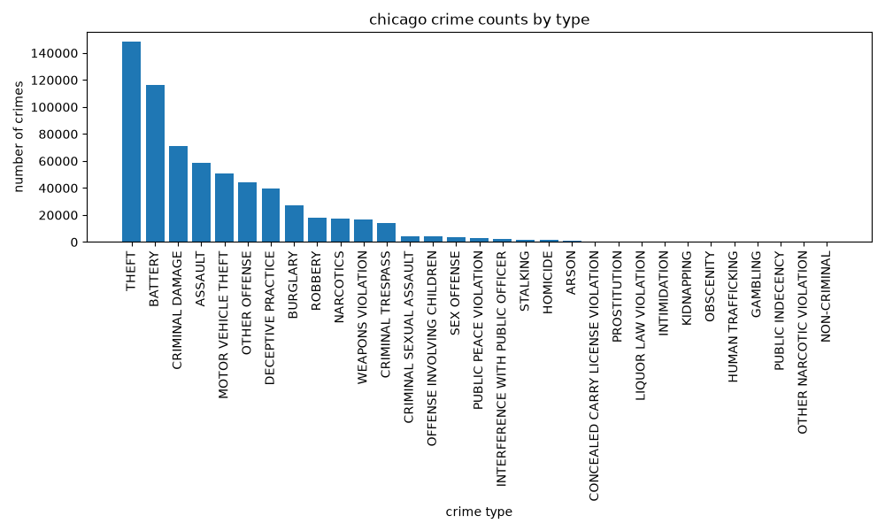
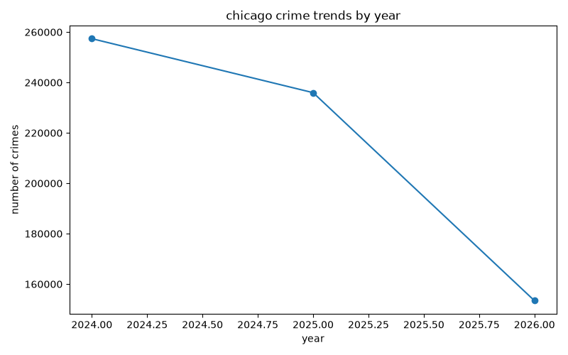
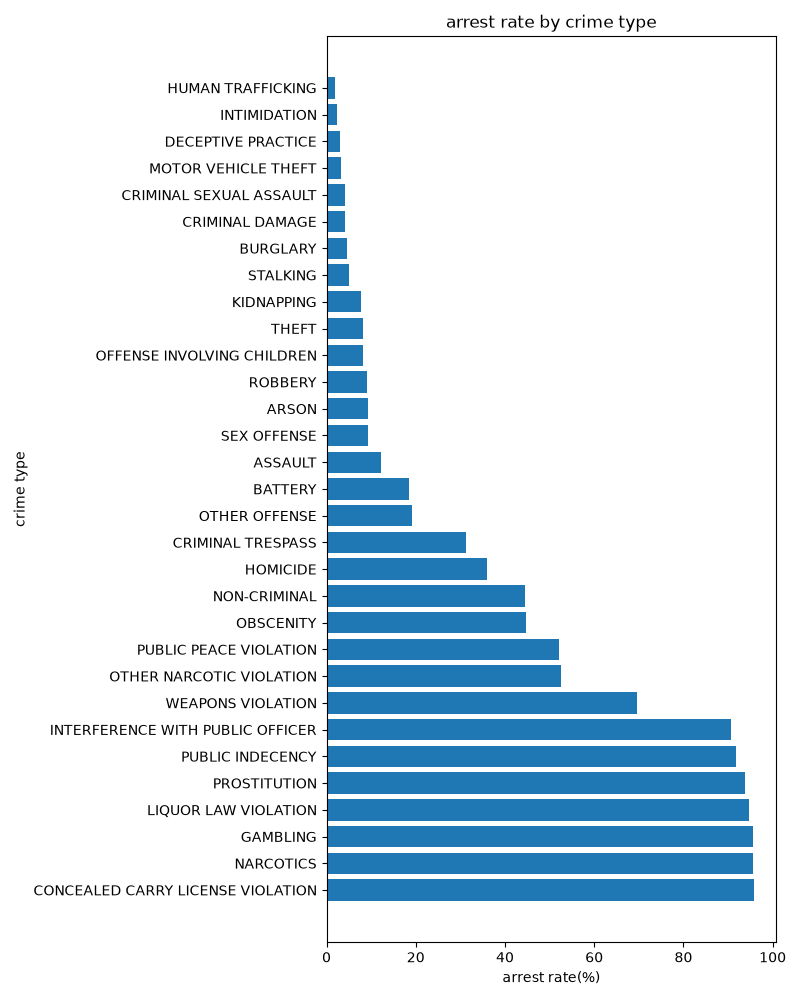
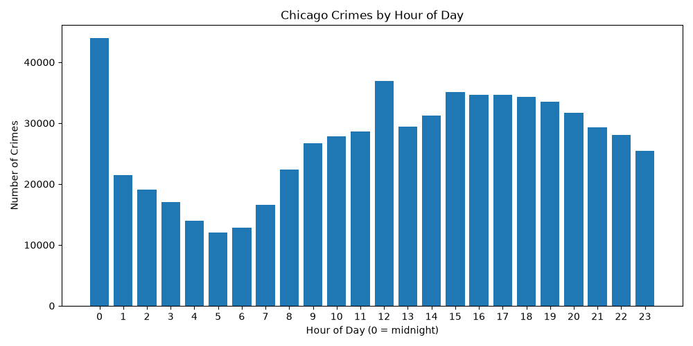
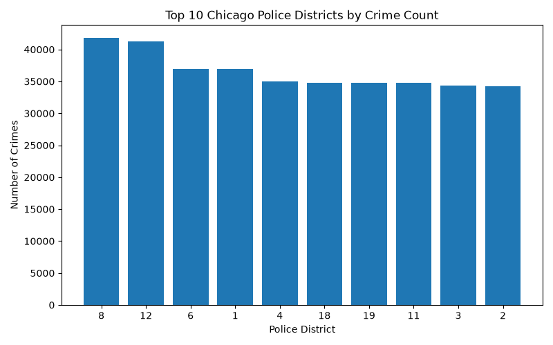

# Chicago Crime Analysis

An end-to-end analysis of **646,771 reported crimes in Chicago (2024 to 2026)**. The data is stored and queried in **MySQL**, then pulled into **Python (pandas + matplotlib)** to build the visualizations below.

The analysis answers five questions:

1. Which types of crime are most common?
2. How is crime volume changing year over year?
3. Which crimes actually lead to arrests?
4. What time of day do crimes happen?
5. Which police districts see the most crime?

---

## Key Findings

### 1. Theft and battery make up about 41% of all reported crime

Theft (148,236 incidents) and battery (116,602) together account for roughly 41% of the 646,771 records. Adding criminal damage, assault, and motor vehicle theft brings the top five to about 69% of all incidents. Crime types beyond the top dozen are a very small share of the total.



### 2. Reported crime fell about 8% from 2024 to 2025

There were 257,392 incidents in 2024 and 235,958 in 2025, a decrease of 8.3%. The 2026 figure (153,421) covers only part of the year, because the data was exported in early September 2026, so it is **not** directly comparable to the full years.



### 3. Arrest rates vary enormously by crime type

Arrest rates range from about 2% to about 96% depending on the crime.

- **Highest:** concealed carry license violations, narcotics, gambling, liquor law violations, prostitution, public indecency, and interference with a public officer are all above 90%. Weapons violations are around 70%.
- **Lowest among high-volume crimes:** theft (8.1%), motor vehicle theft (3.3%), deceptive practice (3.1%), criminal damage (4.2%), and burglary (4.5%).
- Battery, the second most common crime, has an arrest rate of 18.4%.

One possible explanation is that offenses usually detected through police action (drugs, weapons, licensing) lead to an arrest on the spot, while offenses usually reported after the offender has left (theft, burglary, fraud) rarely do. This is a hypothesis suggested by the pattern, not something this analysis tests.



### 4. Crime is lowest around 5 AM and highest at midnight

Reported incidents bottom out at 5 AM (12,016), climb through the morning, and stay high through the afternoon, at roughly 34,000 to 35,000 per hour between 3 PM and 6 PM. The single highest hour is midnight (43,934), followed by noon (36,879) and 3 PM (35,067). The midnight and noon spikes may be partly recording artifacts (see Limitations).



### 5. Districts 8 and 12 have the most reported incidents

District 8 (41,771) and District 12 (41,265) lead, followed by District 6 (36,914), District 1 (36,895), and District 4 (35,049). These are raw counts and are not adjusted for district population or size.



---

## Limitations

- **2026 is a partial year.** The 2024 to 2025 comparison is the only like-for-like yearly comparison here, and two full years is a short window for calling anything a trend.
- **These are reported crimes.** Counts reflect what was reported and recorded, not necessarily everything that happened.
- **Raw counts, not rates.** District comparisons do not account for population, area, or foot traffic, so a higher count does not mean a higher per-person risk.
- **The midnight and noon spikes may be artifacts.** When the exact time of an incident is unknown, records are often logged with a default time such as midnight or noon, which can inflate those hours. Midnight (43,934) is far above the neighboring hours (25,459 at 11 PM), which fits that pattern. This should be verified before drawing conclusions about late-night or midday crime.
- **Arrest rate is an association.** The explanation offered in Finding 3 is a hypothesis. The `Arrest` field also records whether an arrest was made, not whether it led to a conviction.

---

## Data

- **Source:** [City of Chicago Data Portal, "Crimes - 2001 to Present"](https://data.cityofchicago.org)
- **Extracted:** September 8, 2026, filtered to 2024 onward
- **Size:** 646,771 rows, 22 columns (case number, date, block, IUCR code, primary type, description, location description, arrest flag, domestic flag, beat, district, ward, community area, FBI code, coordinates, and more)

The raw CSV (about 183 MB) is not included in this repository because it exceeds GitHub's 100 MB file limit. It is listed in `.gitignore`. See "How to Reproduce" below to download it yourself.

---

## Methods

1. **Database setup.** Created a MySQL database (`chicago_crime`) and a `crimes` table matching the dataset's columns, then loaded the CSV with MySQL Workbench's Table Data Import Wizard.
2. **Exploration in SQL.** Wrote queries using `GROUP BY`, aggregate functions (`COUNT`, `SUM`), conditional aggregation with `CASE WHEN`, date parsing with `STR_TO_DATE` and `HOUR`, `NULL` filtering, and `ORDER BY ... LIMIT`.
3. **Analysis and visualization in Python.** `analysis.py` connects to MySQL with `mysql-connector-python`, loads each query result into a pandas DataFrame, plots it with matplotlib, and saves the chart as a PNG.

### Data handling notes

- Dates are stored as text in the table and converted inside the query with `STR_TO_DATE`.
- The `Arrest` field is stored as the text values `'true'` / `'false'`, so arrest counts use `CASE WHEN`.
- The district query excludes rows with no district recorded.

### Example query: arrest rate by crime type

```sql
SELECT Primary_Type,
       COUNT(*) AS total_crimes,
       SUM(CASE WHEN Arrest = 'true' THEN 1 ELSE 0 END) AS arrests,
       ROUND(SUM(CASE WHEN Arrest = 'true' THEN 1 ELSE 0 END) / COUNT(*) * 100, 1) AS arrest_rate_pct
FROM crimes
GROUP BY Primary_Type
ORDER BY arrest_rate_pct DESC;
```

---

## Tools

- MySQL 9.7 and MySQL Workbench
- Python 3.13 with pandas, matplotlib, and mysql-connector-python
- Git and GitHub

---

## Repository Contents

| File | Description |
|---|---|
| `analysis.py` | Connects to MySQL, runs the five analysis queries, and saves the charts |
| `Chicago-Crime-Analysis-.sql` | SQL written while building the database and exploring the data |
| `crime_by_type.png` | Crime counts by type |
| `crime_by_year.png` | Yearly crime trend |
| `arrest_rate_by_type.png` | Arrest rate by crime type |
| `crime_by_hour.png` | Crimes by hour of day |
| `crime_by_district.png` | Top 10 districts by crime count |

---

## How to Reproduce

1. **Get the data.** On the City of Chicago Data Portal, open "Crimes - 2001 to Present," filter the Date column to 2024 onward, and export as CSV.
2. **Set up MySQL.** Install MySQL, create a database named `chicago_crime`, and create a `crimes` table whose columns match the CSV headers (spaces replaced with underscores, for example `Case_Number`).
3. **Import the CSV** into the `crimes` table (MySQL Workbench's Table Data Import Wizard works).
4. **Install the Python libraries:**
   ```bash
   pip install pandas matplotlib mysql-connector-python
   ```
5. **Check the connection settings** (`host`, `user`, `database`) at the top of `analysis.py` to match your MySQL setup. The script prompts for your MySQL password when it runs, so no password is stored in the file.
6. **Run the script.** Each chart window pauses the script until you close it.
   ```bash
   python3 analysis.py
   ```

---

## Possible Next Steps

- Compare the same months across 2024, 2025, and 2026 to get a fair view of the 2026 trend.
- Normalize district and community area counts by population to compare crime rates rather than raw counts.
- Join in community area reference data to analyze crime by neighborhood.
- Map incidents using the latitude and longitude columns.

---

## Author

Built by Geetanjali Angati, a student at the University of Illinois Chicago pursuing a B.S. in Information and Decision Sciences and a B.A. in Economics.
